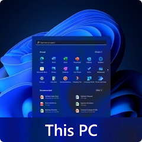
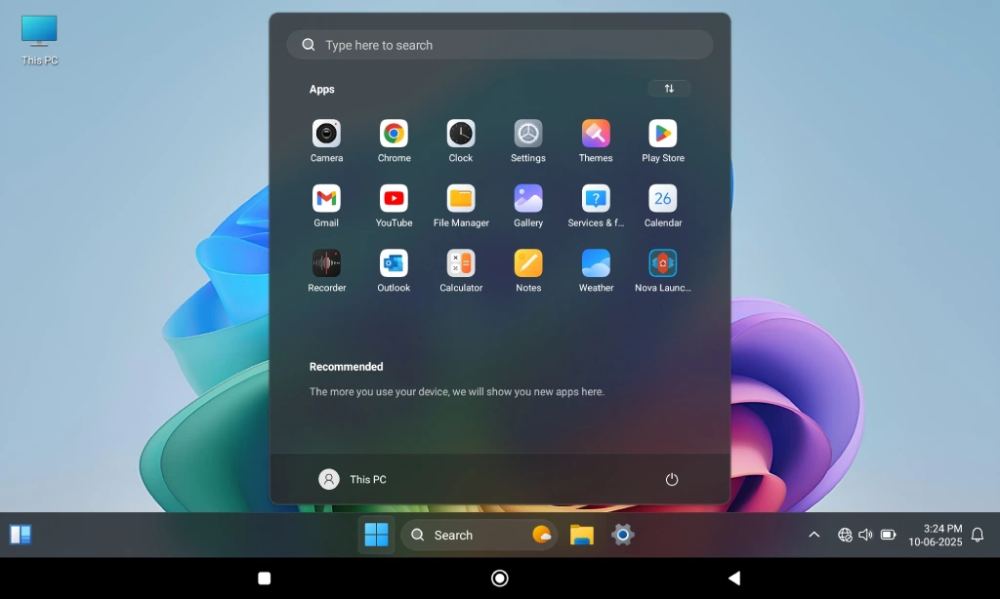
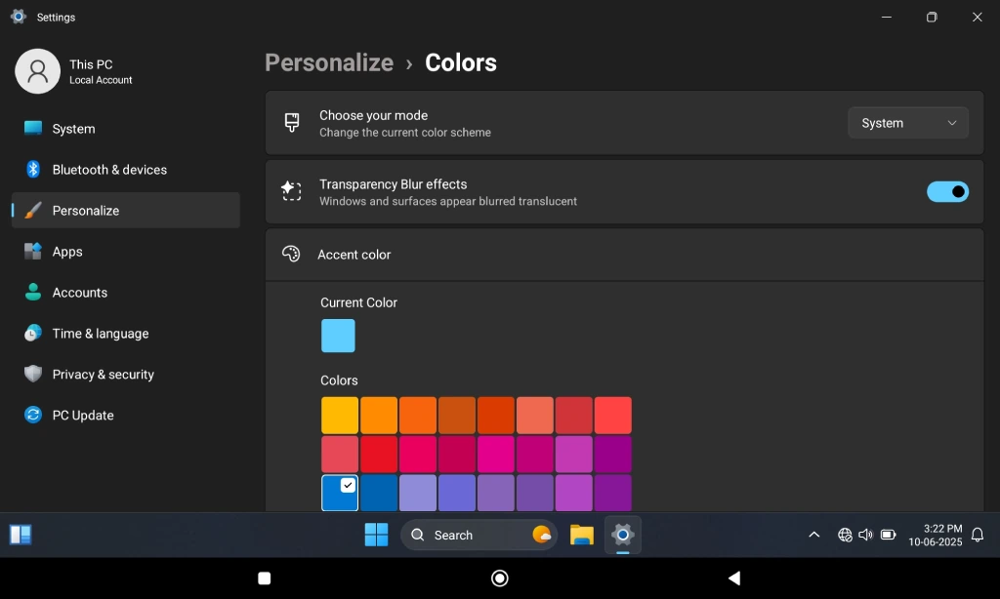
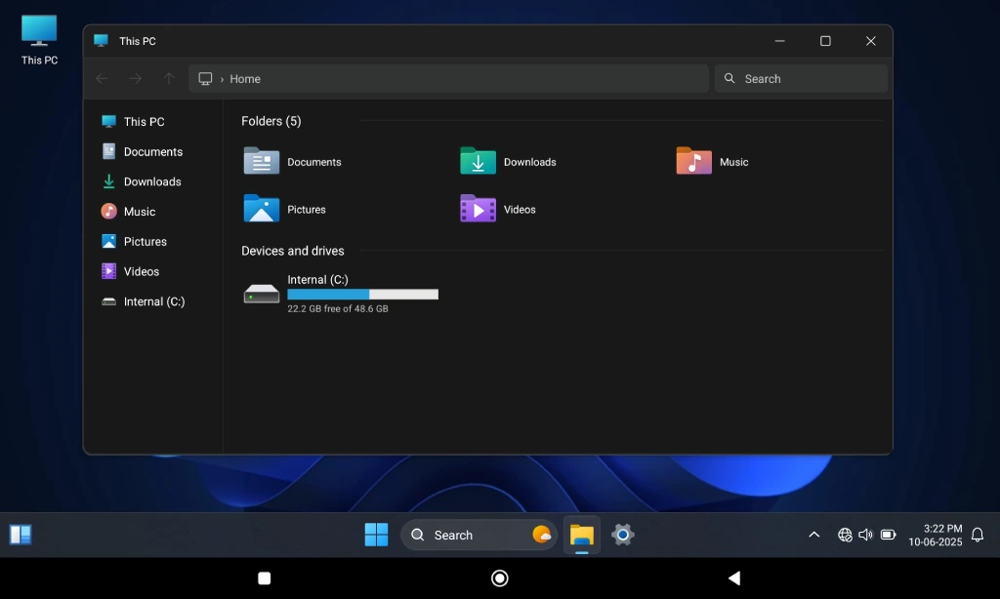
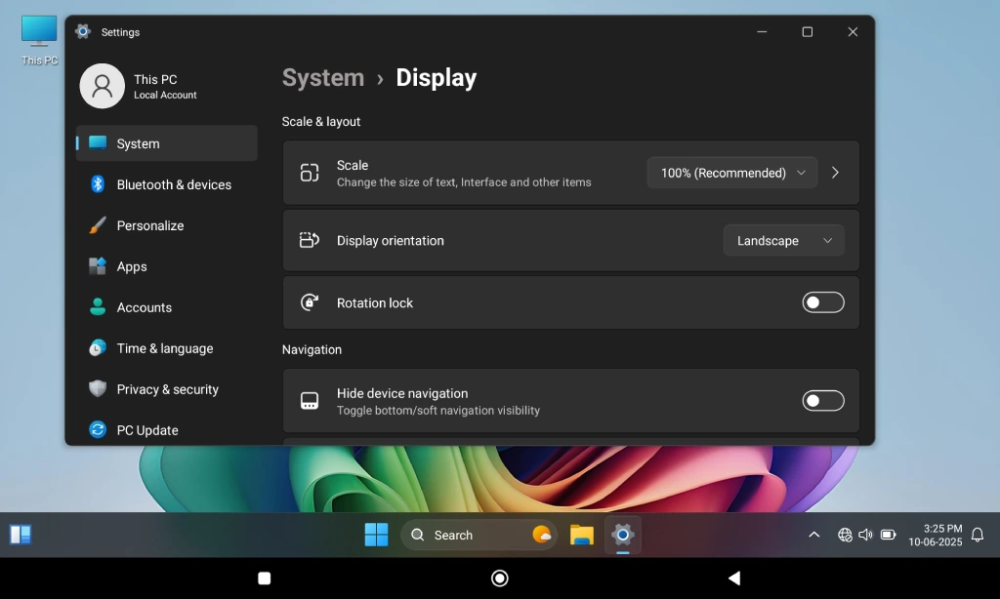

<h1 align="center">HyperDroid - PC Launcher</h1>

<strong>Bring a desktop experience to your Android device.</strong>
 
A Desktop-inspired launcher designed for multitasking, customization, and productivity.

---

## Screenshots

      &nbsp;              &nbsp;    

---

## Features

| Feature                      | Description                                                                                         |
| :--------------------------- | :-------------------------------------------------------------------------------------------------- |
| **Desktop Experience**       | A familiar, intuitive desktop-style interface optimized for touchscreens, keyboards, and mice.      |
| **Floating Windows**         | Launch supported WebApps in resizable floating windows for a more flexible multitasking experience. |
| **Display Scaling**          | Customize display density to suit your screen size and personal preferences.                        |
| **Multi-language Support**   | Use HyperDroid in multiple languages for a more accessible experience.                              |
| **Built-in File Manager**    | Browse and manage your files through an integrated file explorer.                                   |
| **App Personalization**      | Customize installed app icons and names to make your desktop your own.                              |
| **Default Launcher Support** | Optionally set HyperDroid as your Android device's default home launcher.                           |

## Set as Default Launcher
For a more integrated desktop experience, you can optionally set HyperDroid as your default launcher.
 
**`HyperDroid Settings` → System → Default Launcher → Enable as launcher**

---

## Links

  

</a>

